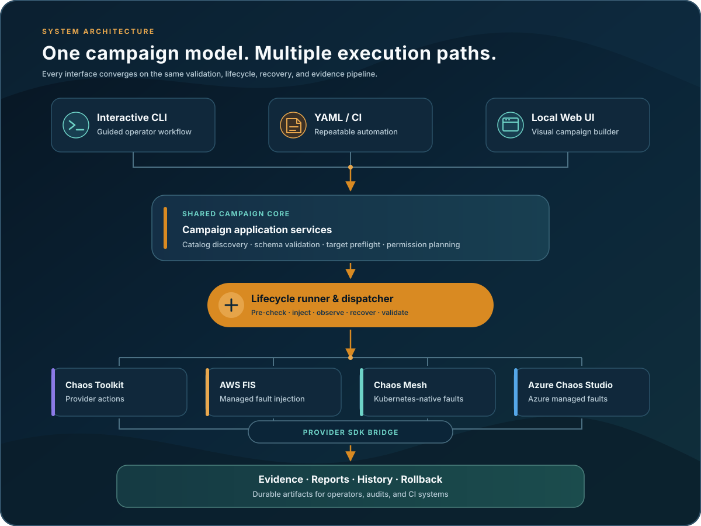

<div align="center">

  

  <h1>ChaosForge</h1>

  <p>
  <strong>Campaign-driven chaos engineering for AWS, Azure, and Kubernetes.</strong>
  </p>

  <p>
  Design controlled faults, verify the blast radius, execute with recovery awareness,
  and retain evidence from every run.
  </p>

  <p>
  
  
  
  </p>

  <p>
  <a href="docs/README.md">Documentation</a> &bull;
  <a href="docs/getting-started/installation.md">Installation</a> &bull;
  <a href="docs/user-guide/yaml-execution.md">YAML Guide</a> &bull;
  <a href="examples/campaigns/">Examples</a>
  </p>

</div>

> [!WARNING]
> Chaos experiments can interrupt services, alter infrastructure, and delete data.
> Start in a dedicated non-production environment with least-privilege credentials,
> a tightly bounded target, and a tested recovery procedure. Always review the
> required permissions and execution plan before injecting a fault.

## Contents

[Overview](#overview) &bull;
[Platforms](#supported-platforms) &bull;
[Architecture](#how-it-works) &bull;
[Quick Start](#quick-start) &bull;
[Interfaces](#choose-an-interface) &bull;
[Safety](#safety-model) &bull;
[Documentation](#documentation) &bull;
[Development](#development)

## Overview

ChaosForge turns individual fault experiments into repeatable campaigns. Platform
teams can build and run the same catalog-backed experiments through an interactive
Rich CLI, portable YAML, or a local Web interface. Every path uses shared campaign,
validation, dispatch, recovery, evidence, and reporting services.

| Capability | What ChaosForge provides |
|---|---|
| Multi-cloud catalog | AWS and Azure service experiments, AWS FIS, AKS, EKS, and direct Chaos Mesh faults |
| Guided campaign design | Dynamic resource discovery, metadata-driven inputs, campaign editing, and cloud-scoped drafts |
| Safety-oriented lifecycle | Pre-checks, baseline capture, fault observation, post-validation, recovery checks, and explicit outcomes |
| Automation-ready YAML | Environment-bound campaigns with schema validation, target preflight, planning, permission reports, and non-interactive execution |
| Evidence-first execution | Durable history, structured evidence bundles, logs, reports, and target-scoped rollback state |
| Shared interfaces | Consistent behavior across the interactive CLI, YAML commands, and localhost Web UI |

Availability depends on the selected experiment, provider region, account or
subscription configuration, service quotas, installed tooling, and IAM/RBAC
permissions.

## Supported Platforms

ChaosForge uses a catalog of provider-owned experiment definitions and dispatches
each experiment to the appropriate execution engine.

| Platform | Representative targets | Execution paths |
|---|---|---|
| AWS | API Gateway, DynamoDB, EC2/EBS, ECS, EKS, ElastiCache, Elastic Load Balancing, Lambda, RDS, S3, SNS, and VPC | Chaos Toolkit, AWS SDK actions, AWS FIS, and Chaos Mesh |
| Azure | AKS, Cache for Redis, Virtual Machines, VM Scale Sets, App Service, Functions, Key Vault, Cosmos DB, Event Hubs, PostgreSQL Flexible Server, and Container Apps | Azure Chaos Studio, Azure SDK actions, and direct Kubernetes/VMSS operations |
| Kubernetes | EKS and AKS workloads, nodes, networking, stress, I/O, DNS, HTTP, time, and scheduling faults | Kubernetes API and Chaos Mesh custom resources |

See the [AWS](docs/providers/aws.md) and [Azure](docs/providers/azure.md)
provider guides for experiment-specific requirements and behavior.

## How It Works

<div align="center">
  
</div>

Campaign experiments run sequentially. For each experiment, ChaosForge validates
metadata, runs available pre-checks, captures a baseline, injects the fault,
performs post- and recovery validation, and writes evidence. A campaign can stop
at its first failure or continue and record the remaining outcomes.

Possible experiment outcomes are `SUCCESS`, `SUCCESS_WITH_WARNINGS`, `FAILED`,
and `SKIPPED`. Advisory findings remain visible without being treated as blocking
recovery failures.

## Requirements

### Required

- Python 3.14 or newer; earlier Python versions are unsupported.
- Provider credentials for the account or subscription being tested.
- Git when installing from this repository.

### Workflow-dependent

- Valid AWS SDK credentials for AWS and AWS FIS workflows. AWS CLI is optional
  and can be used to configure or verify local credentials.
- Azure CLI for interactive local Azure authentication and subscription
  selection. Azure SDK actions use `DefaultAzureCredential`.
- A valid kubeconfig context or in-cluster identity for EKS and AKS workflows.
- Helm when ChaosForge needs to install Chaos Mesh. `kubectl` is optional for
  manual troubleshooting and compatibility fallbacks.
- Locust for experiments that generate a Lambda invocation storm.

## Quick Start

From the repository root on macOS or Linux:

```bash
python3.14 -m venv .venv && source .venv/bin/activate
python -m pip install --upgrade pip
python -m pip install -e .
chaosforge
```

Windows activation commands and provider-specific setup are covered in the
[installation guide](docs/getting-started/installation.md).

Verify the installed entry points:

```bash
python --version
chaosforge --help
python -c "import chaosforge; import chaosforge.interfaces.web"
```

### Configuration Defaults And Validation

Experiment metadata defines defaults, required values, allowed choices, types,
and numeric ranges. The interactive CLI, Web forms, and YAML workflows apply the
same catalog-backed validation before provider actions run; environment-specific
resource targets remain required.

## Choose an Interface

### Interactive CLI

Launch Mission Control to authenticate with a provider, discover resources,
build a campaign, review required permissions, and execute selected experiments:

```bash
chaosforge
```

The CLI also manages cloud-scoped campaign drafts and shared execution history.

### YAML Automation

Use an environment-bound campaign for repeatable local or CI/CD execution:

```bash
chaosforge validate campaign.yaml
chaosforge permissions campaign.yaml
chaosforge plan campaign.yaml
chaosforge run campaign.yaml
```

| Command | Purpose |
|---|---|
| `validate` | Checks YAML structure, catalog identities, variables, provider identity, and target preflight without injecting a fault |
| `permissions` | Produces a read-only IAM or RBAC requirement report from catalog metadata |
| `plan` | Resolves targets and presents blockers, warnings, blast radius, and expected recovery behavior |
| `run` | Executes the validated campaign sequentially through the shared lifecycle |

`chaosforge run` is intentionally non-interactive. Use it only after the campaign,
permissions, targets, and plan have been reviewed. Permission reports can also be
written for automation or review:

```bash
chaosforge permissions campaign.yaml --format json
chaosforge permissions campaign.yaml --format markdown --output permissions.md
```

The legacy `chaosforge --yaml campaign.yaml` execution form remains available.

All fault-duration inputs use ISO-8601 syntax, for example `PT30S`, `PT5M`, or
`PT1H`. ChaosForge keeps this portable value in campaign YAML and automatically
converts it to seconds or Kubernetes duration syntax when a local SDK, Toolkit,
AKS, or Chaos Mesh execution path requires a native value.

### GitLab Test Reports

YAML campaign runs can emit GitLab-compatible JUnit XML:

```bash
chaosforge run campaign.yaml \
  --junit-output runtime/reports/chaosforge-junit.xml
```

Each campaign is a JUnit test suite and each chaos experiment is a testcase.
`SUCCESS` and `SUCCESS_WITH_WARNINGS` are passed tests, `FAILED` is a failed
test, and `SKIPPED` is a skipped test. Validation, planning, or setup failures
produce a synthetic failed **Campaign setup** testcase so GitLab still displays
the reason when no experiment starts.

```yaml
chaos_test:
  stage: test
  script:
    - chaosforge run campaigns/azure-resilience.yaml --junit-output runtime/reports/chaosforge-junit.xml
  artifacts:
    when: always
    reports:
      junit: runtime/reports/chaosforge-junit.xml
    paths:
      - runtime/reports/
      - runtime/evidence/
```

### Local Web UI

```bash
chaosforge-web
```

Open [http://127.0.0.1:5000](http://127.0.0.1:5000) to browse provider catalogs,
discover targets, upload or export YAML, manage campaigns, review permissions,
and follow live execution logs.

> [!CAUTION]
> The Web interface is a local operator tool. It has no production authentication,
> authorization, CSRF protection, or multi-user isolation. Do not expose it on a
> network or place it behind a public endpoint.

## Campaign Templates

The files under [`examples/campaigns/`](examples/campaigns/) are reusable
templates, not immediately executable campaigns. Before validation or execution:

1. Copy the template to a working file.
2. Replace all placeholder resource names with dedicated test targets.
3. Add `environment.account_id` for AWS or `environment.subscription_id` for Azure.
4. Confirm that the environment identity matches the active provider credentials.
5. Remove `template: true`.
6. Run `validate`, `permissions`, and `plan` before `run`.

A minimal executable AWS campaign has this shape:

```yaml
campaign:
  name: Lambda resilience
  continue_on_failure: false

cloud:
  provider: aws

environment:
  name: engineering-dev
  account_id: "123456789012"

experiments:
  - service: lambda
    experiment: lambda-timeout
    variables:
      lambda_name: example-function
      aws_region: eu-central-1
      target_timeout: 10
      wait_seconds: PT30S
```

Executable campaigns are bound to the active cloud identity. Before import,
planning, or execution, ChaosForge resolves supplied catalog targets and rejects
identity mismatches or nonexistent resources.

## Safety Model

ChaosForge adds lifecycle controls around fault injection, but it cannot make a
destructive experiment risk-free.

### Reversibility

ChaosForge assigns every catalog experiment one safety label. The label is owned
by the installed catalog; operators do not choose it.

| Label | Meaning |
|---|---|
| **Reversible** | ChaosForge, the provider, or the workload controller restores the temporary fault or captured original state. |
| **Irreversible** | ChaosForge cannot reliably restore the original resource, data, identity, topology, or external side effect. |

Web and CLI catalog, campaign, and execution views display the label. Interactive
execution requires a typed acknowledgement when the selected set includes an
irreversible experiment. CI/CD YAML remains non-interactive and must declare its
acknowledgement when it contains one:

```yaml
campaign:
  irreversible_operations_acknowledged: true
```

This acknowledges catalog-classified risk; it does not change the experiment's
classification or guarantee that an unsafe operation can be recovered.

- Review exact account, subscription, region, cluster, namespace, and resource
  identifiers before execution.
- Generate the permission report and use the narrowest practical IAM/RBAC scope.
- Treat API acceptance as the start of an operation, not proof that the fault was
  applied or that the target recovered.
- Confirm the experiment's rollback semantics. There is no universal
  campaign-wide compensating transaction.
- Treat irreversible operations, including Azure Cache for Redis flush, as data
  deletion and use disposable targets.
- Allow graceful shutdown to complete provider cleanup and rollback. `SIGKILL`,
  host failure, and power loss cannot run Python cleanup.
- Inspect lifecycle evidence and provider-side status before retrying a failed or
  interrupted target.

## Runtime Artifacts

Generated state is repository-rooted under `runtime/` and excluded from source
control:

```text
runtime/
├── campaigns/    # Cloud-scoped local drafts
├── evidence/     # Structured experiment evidence and bundles
├── executions/   # Durable campaign snapshots and history
├── logs/         # Runtime logs
├── reports/      # Human-readable campaign reports
├── rollback/     # Target-scoped recovery state
└── settings.json # Local presentation preferences
```

Evidence timestamps remain in UTC. Reports and interface displays use the local
configured IANA timezone, which defaults to `Europe/Berlin` and can be overridden
per executable campaign.

> [!IMPORTANT]
> Runtime artifacts can contain cloud identifiers, target names, provider output,
> and failure details. Handle them as operational data and review them before
> sharing.

Portable YAML exports and local drafts are separate: YAML is intended for review
and controlled reuse, while local draft and execution records preserve operator
state and history on the current machine.

## Documentation

| Guide | Contents |
|---|---|
| [Documentation index](docs/README.md) | Complete documentation map |
| [Installation](docs/getting-started/installation.md) | Platform setup, credentials, and prerequisites |
| [Campaign management](docs/user-guide/campaigns.md) | Drafts, editing, execution, and history |
| [YAML execution](docs/user-guide/yaml-execution.md) | Schema, templates, identity binding, planning, permissions, and automation |
| [Web interface](docs/user-guide/web-interface.md) | Local Web workflows and behavior |
| [AWS and AWS FIS](docs/providers/aws.md) | AWS discovery, experiments, FIS, IAM, and recovery |
| [Microsoft Azure](docs/providers/azure.md) | Azure components, Chaos Studio, SDK actions, RBAC, and recovery |
| [Architecture](docs/developer-guide/architecture.md) | Package boundaries and execution design |
| [Adding a provider](docs/developer-guide/adding-a-cloud-provider.md) | Provider extension contract |
| [Adding an experiment](docs/developer-guide/adding-an-experiment.md) | Catalog, action, validation, rollback, and testing workflow |
| [Testing](docs/validation/testing.md) | Local checks, coverage, and validation strategy |

## Development

The installable package lives under `chaosforge/`. Provider-specific discovery,
metadata, definitions, and actions belong in `chaosforge/providers/`; execution
engine mechanics belong in `chaosforge/engines/`; interface code delegates to
shared application and lifecycle services.

Install Ruff separately for local development, then run the standard checks:

```bash
python -m pip install ruff
python -m ruff check chaosforge tests scripts loadtests
python -m pytest tests --cov=chaosforge --cov-fail-under=100 --cov-report=term-missing
git diff --check
```

Cloud and Kubernetes tests must mock provider boundaries unless an explicitly
authorized integration environment is available.
